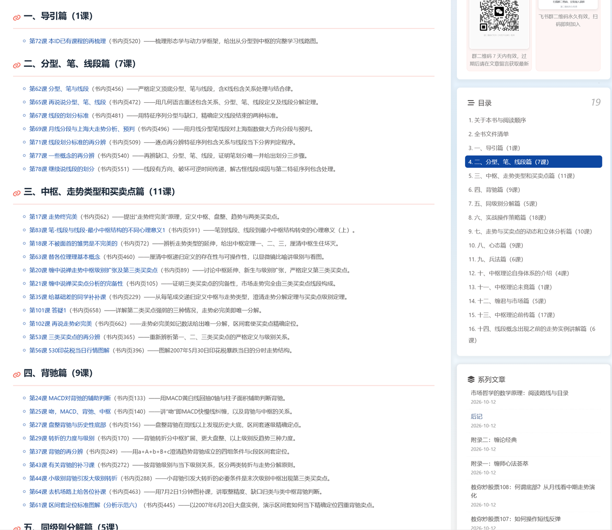
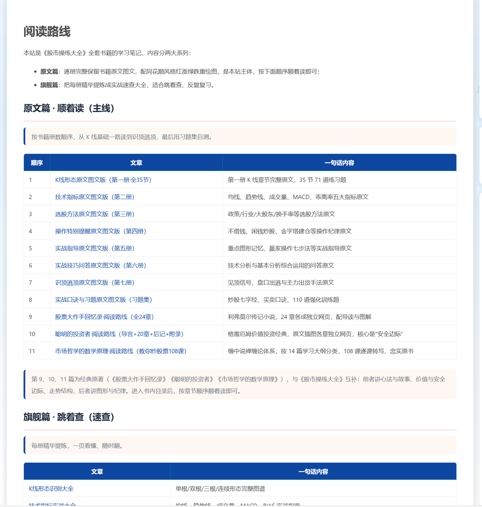
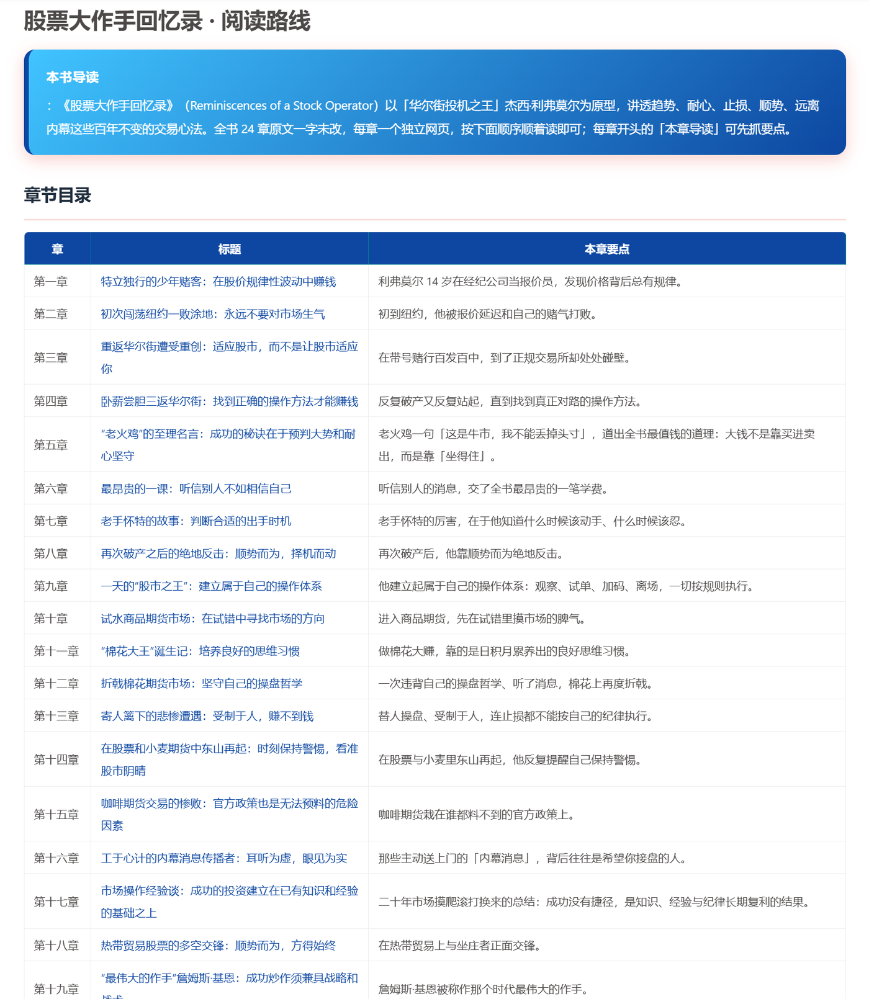
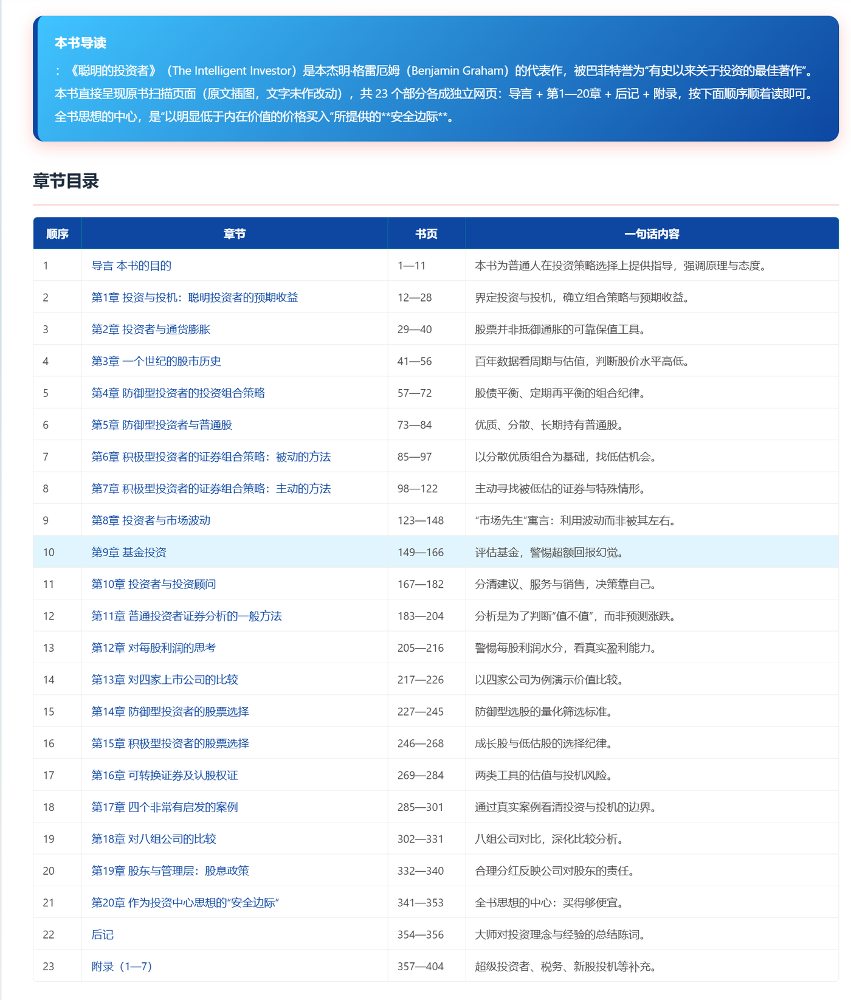
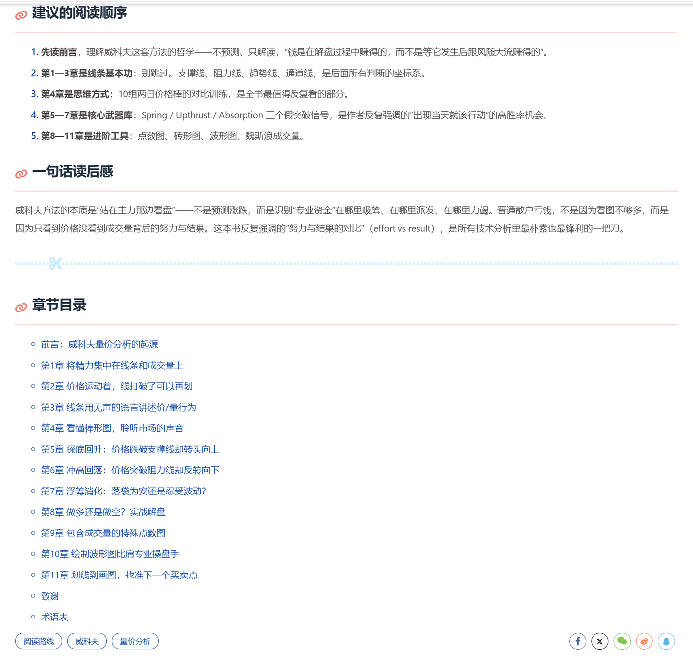

# blog-InvestLore · 股市操练笔记

把《股市操练大全》等五套股票经典书籍，整理成便于阅读的**图文网页**，点开每本书进入它的阅读路线，按章节顺序顺着读即可。

**🌐 线上地址：https://zhangzhh13.xyz/blog/**

---

## 收录书籍

本站共整理五套股票经典，互为补充：**操练大全教你"认脸谱"，威科夫教你"读人心"，回忆录讲心法，聪明的投资者讲价值与安全边际，缠论讲走势结构的数学原理。**

| 书籍 | 内容 |
| --- | --- |
| 《股市操练大全》 | 第一至七册 + 习题集。K 线形态、技术指标、选股方法、操作纪律、实战指导、识顶逃顶，配同花顺风格红涨绿跌重绘图 |
| 《股票大作手回忆录》 | 埃德温·勒菲弗 · 全 24 章。以利弗莫尔为原型的交易心法，每章独立网页、配导读 |
| 《聪明的投资者》 | 本杰明·格雷厄姆 · 导言 + 20 章 + 后记 + 附录。价值投资经典，核心是"安全边际"，原书扫描页面 |
| 《威科夫量价分析图解》 | 戴维·H.魏斯 · 全 11 章。量价分析，三大假突破信号，原书 142 幅走势图全部保留 |
| 《市场哲学的数学原理》 | 缠中说禅 · 教你炒股票 108 课。按 14 篇学习大纲分类，108 课逐课转写为纯文字网页、忠实原书 |

每本书都提供清晰的**阅读路线 / 章节目录**，章首配导读、先抓要点再细读正文；《股市操练大全》还分**原文篇**（顺着读主线）与**旗舰篇**（跳着查速查）两大系列。

---

## 页面截图

**📚 书籍首页 —— 五套经典卡片，一键进入阅读路线**

**🎯 《市场哲学的数学原理》· 108 课阅读路线与目录（按 14 篇大纲分类）**

**📖 《股市操练大全》· 阅读路线（原文篇 + 旗舰篇）**

**📗 《股票大作手回忆录》· 阅读路线（导读 + 24 章目录）**

**📘 《聪明的投资者》· 阅读路线（导读 + 23 部分目录）**

**📈 《威科夫量价分析图解》· 建议阅读顺序 + 读后感 + 章节目录**

---

## 风险提示

本站为**个人学习笔记**，仅供学习参考，**不构成投资建议**。股市有风险，入市需谨慎。
